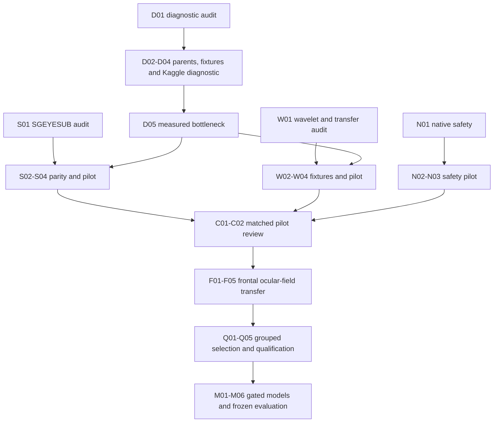

# Regional diagnostic and challenger execution plan

Created 13 October 2026. Active checklist: [TASKS.md](../TASKS.md).
Update: the full frozen diagnostic is verified; see
[REGIONAL_DIAGNOSTIC_RESULTS.md](REGIONAL_DIAGNOSTIC_RESULTS.md).
The user authorized the immediate four-arm verified central/shared extension:
[CENTRAL_COVERAGE_PLAN.md](CENTRAL_COVERAGE_PLAN.md), reviewed by GPT-6.1 Sol
with extra-high reasoning in
[CENTRAL_COVERAGE_PLANNING_REVIEW.md](CENTRAL_COVERAGE_PLANNING_REVIEW.md).
Its pilot and full run are verified; see
[CENTRAL_COVERAGE_RESULTS.md](CENTRAL_COVERAGE_RESULTS.md). Whole-cap output
SNR is 13.162704 dB; frontal CC and native preservation still fail qualification.
Notebook50's full matched context comparison is complete and verified:
[MATCHED_CONTEXT_RESULTS.md](MATCHED_CONTEXT_RESULTS.md). Whole output SNR is
13.183201 dB raw context versus13.162704 VMD context; no representation
advantage is established. The same scored VMD frontal outputs remain in both.
The active experiment is notebook51's fixed native frontal separate-axis
support pilot, `frontal-native-separate-axis-001/1`, source `ce6f31d`:
[FRONTAL_PRESERVATION_REPAIR_PLAN.md](FRONTAL_PRESERVATION_REPAIR_PLAN.md).
It completed202tests/51trials/153predecessorchecks. Separate support improves
resting preservation but still fails modification/covariance; suppression
trade-offs remain. See [NATIVE_SEPARATE_AXIS_RESULTS.md](NATIVE_SEPARATE_AXIS_RESULTS.md).
Next is saved-output diagnosis, without additional fitting. Qualification remains false.
Mode: Super Code. Independent read-only audits prepare reviewable contracts;
the primary owns implementation, Git publication and Kaggle submissions.

## Objective and constraints

Improve blink and lateral suppression with neural preservation. Current evidence:
[REGIONAL_RESULTS.md](REGIONAL_RESULTS.md). Whole-cap target remains >=15 dB,
20 dB stretch. Native frontal preservation failed on two tested development
recordings; native central transfer is untested. No qualified winner exists.
Freeze frontal VMD K3/alpha2000, no AutoVMD or posterior VMD. Main processing stays
200 Hz, 0.5–40 Hz, 1024-sample windows and 512-sample hop. Preserve original
references, units, recipient/donor folds, calibration/scoring and trial boundaries.
Do not infer anatomy. Both branches estimate artifacts relative to original EEG;
combine disjoint estimates and subtract once. Disclose reference information access.
All numerical work is on Kaggle; local authoring, static inspection, Git,
submission and artifact retrieval only. Every notebook pins an exact published SHA
and versioned parents. Confirmation data remain closed.

## Parallel lanes and dependencies

| Lane | Owner | Independent preparation | Deliverable |
|---|---|---|---|
| Error/coverage | GPT-6 Luna, high | D01 prediction schema/input audit | Diagnostic contract and payload requirements |
| SGEYESUB | GPT-6 Luna, high | S01 author-code/calibration audit | Eligibility, parity and dependencies/blockers |
| Wavelet/transfer | GPT-6 Luna, high | W01 method/interface audit | Scale/interval/context and preservation contracts |
| Coordination/native safety | Primary | N01 plus ledger/scope repair | Safety design and integrated current checklist |

Audits are read-only to avoid shared-file conflicts. Following verified diagnostics
and method fixtures, SGEYESUB and wavelet pilots can use separate Kaggle CPU jobs
if quotas permit. They consume identical immutable parents and scoring intervals.
No extra broad search. Dependent runs wait for retrieved/verified completion.

## Diagnostic: D01–D05

Inputs: `regional-full-001`, source
`eadff90f6411ba48e6f8cc133b08c211da95d157`, kernel
`satyapaladugu/vmd-regional-composition-full/1`; immutable prediction/selection
manifests and metric tables. Saved `regional_predictions/*.npz` contain original,
target, names, mask, regions and estimates for every arm. Existing per-channel CSV
contains scores but not region/mask metadata; join by exact example/channel identity.
Summary JSON alone cannot diagnose the gap.

Preserve region codes: 0 frontal, 1 posterior, 2 central/shared metadata group,
3 unclassified/unknown. Frontal eligibility is revalidated by the existing name
whitelist. Report 2 and 3 separately; do not silently rewrite routing labels.
Coverage and channel-balanced score partition need exact membership metadata and
score tables. Exact waveform-derived pooled-energy partition needs saved prediction
arrays unless adequate full-precision sufficient statistics are verified.
Prefer attaching immutable Kaggle parents rather than downloading all waveforms locally.

Compute on Kaggle: target energy, input and corrected error, modification energy,
counts and coverage by channel/region/recipient/condition/input level. Compare
channel-first participant-balanced SNR against separately labelled pooled-energy
SNR. Do not add regional dB or use mean dB to infer energy contributions.

Acceptance: all 320 example/32 recipient identities match; available rows partition
exactly once; regional energy/count sums match whole totals at declared tolerance;
unchanged-arm metrics reproduce archived values; remaining pass-through equals input;
all failed cases remain scored. Three decomposition failures must not be relabelled
as 170 distinct failures because the reporting labels propagate per example.

Outputs: notebook, error-energy/coverage/aggregation tables, failure tables, figures,
and measured bottleneck decision. Only this evidence can justify a predeclared
non-VMD correction extension for verified central anatomy; unknown anatomy stays unknown.

## Native safety: N01–N03

Inspect existing frontal/native predictions and calibration decisions for corrections
during resting EEG. Verify original HEOG/VEOG references, whole-trial labels, units
and calibration eligibility. Bound detection/strength tuning to existing candidate
banks and development folds, without held-out scoring adaptation. Keep K/alpha fixed.
Save decisions, coefficients, trigger rates, missing-reference flags and failures.
Report worst-record rest modification/RMSE, alpha/beta error, covariance error and
separate blink/vertical and lateral correlation. Native EEG has no reconstruction SNR.
Synthetic clean identity success does not replace native resting preservation.

## Posterior challengers: S01–S04 and W01–W04

SGEYESUB: inspect [author code](https://github.com/rkobler/eyeartifactcorrection)
and [paper](https://doi.org/10.1016/j.neuroimage.2020.117000), required calibration
classes and solver dependencies; verify native OSF eligibility per record. Establish
reference execution/parity before calling a port a reproduction. Posterior-only
output is our regional adaptation. Record an explicit blocker if reference execution
is unavailable; generic GEVD must not be renamed as SGEYESUB.

The source audit identifies a concrete data prerequisite: `osf_reader.read_osf`
parses sample-level `ARTIFACTCLASSES`, but `data.cache_osf` does not retain those
labels. Current `trial_types` encode 1 rest / 2 lateral / 3 vertical / 4 blink;
the author's sample classes encode 1 right / 2 left / 3 up / 4 down / 5 blink /
6 rest. These are different schemas and must never be remapped by guessing from
trial type. S01a must recover original sample labels into an additive, versioned
calibration artifact, preserve class meaning and verify categorical resampling
alignment, boundaries and sufficient class coverage per eligible development record.
Missing classes remain explicit ineligibility, not fabricated labels.

Pin upstream source and helper/license provenance. Reference training uses a custom
proximal elastic-net logistic solver with covariance penalty, not a generic sklearn
logistic fit. Audit MATLAB/EEGLAB and preprocessing dependencies before committing
to reference execution. Reference-demo preprocessing and the main 200 Hz campaign
are distinct parity layers. Validate solver/output parity at matched inputs on Kaggle;
if a supported reference backend is unavailable, record the exact blocker and label
a separately tested port/adaptation honestly.

For the closest posterior-output adaptation, fit the verified full spatial montage
and correct posterior output rows only; posterior-restricted fitting is a different
arm. Frontal support access must remain explicit. Preserve upstream helper licensing
and attribution before copying code; the audited repository and covariance helper
have different license declarations. No external code is copied by this planning step.

Selective wavelet–ICA: inspect the
[original paper](https://pmc.ncbi.nlm.nih.gov/articles/PMC6956025/); reuse audited
calibration ICA/reconstruction interfaces, modify declared contaminated component
intervals, verify physical scales at 200 Hz and crop/padding/trial edges. Separate
paper detector settings from EOG-assisted adaptations. Whole-component rejection
is a control where eligible, rather than an assumed equivalent operation.

Reuse `posterior.fit_ica`, `posterior_context.context_input`,
`posterior_context.compose_correction`, `regional_integration.load_frontal`,
`native_protocol` and `paper_metrics`. The source audit identifies Infomax,
sym4/five-level DWT, one-second event windows and a 60% coverage whole-component
fallback as reference details requiring verification. Picard, HEOG/VEOG selection,
different interval policy or 200 Hz coefficient choices are declared adaptations.
Test unchanged component samples outside detected intervals explicitly.

Both lanes compare identity, posterior pass-through, direct HEOG/VEOG regression and
full-montage ICA/posterior-output under the same frontal method, data, boundaries,
information access and budgets. Fixtures must cover no-correction identity, component
reconstruction, metadata/masks, calibration leakage, event/trial edges, failure
pass-through and recovery. Only verified eligible pilots advance to full comparison.

## Frontal field transfer: F01–F05

Dependency: diagnostic evidence and validated frontal artifact estimates on **unscored
calibration**, with quality flags. Saved scoring-window estimates alone cannot fit
calibration transfer. Frontal estimates may contain neural leakage; they are not
clean ocular ground truth. Separate common/blink, left/right/midline and signed
right-minus-left context. Fit transfer to original posterior calibration EEG, never
scoring clean targets. Compare no/common/signed artifact context at matched budgets,
with raw frontal support control to isolate the value of artifact estimates.

Tests: disjoint masks, metadata permutation, missing sides/midline, failed-context
pass-through, exact identity and single original-input subtraction. Strong frontal
contamination alone does not justify high posterior correction. Frontal-estimated
blink propagation has [precedent](https://doi.org/10.1016/j.bspc.2018.05.012), but
our VMD/lateral extension remains a hypothesis.

## Selection, qualification and models: Q01–Q05, M01–M06

Use grouped development sources and bounded recipes. Primary paper metrics include
MSE, temporal/spectral RRMSE where prescribed, ordinary Pearson CC, output SNR and
SNR improvement separately. Native reference correlations, resting RMSE and spectral
preservation remain separate from paired metrics. Report per-channel/per-record,
blink/lateral/mixed and input-level tables, recipient/donor-aware uncertainty,
all failures, computational cost and regression-derived-mixture construction bias.

Engineering qualification: output SNR >=15 dB; <=1% worst-participant/record mean
clean modification; <=0.5 dB alpha/beta error; <=0.02 relative covariance error;
<=0.005 paired CC deterioration against declared comparator. No relaxed thresholds.
A completed experiment or passing fixture is not a qualified teacher or deployment.

Following the required classical checkpoint, compare paired EEG-only compact CNN,
TCN-only and TCN–BiGRU with matched splits/budgets. Add only eligible source-excluded
teacher supervision and retain it only if it improves paired-only learning. Freeze
model, preprocessing, gates and analysis before reserved and independent evaluation.
Verify fresh CPU loading, export parity, overlap-add and 10–50-channel measured
runtime/memory. Offline recurrent inference does not establish causal operation.

## Persistence, monitoring and stop rules

Read-only audits D01, S01 and W01 completed during checklist preparation; no new
numerical job launched. Per-record SGEYESUB eligibility, custom solver/reference
parity, diagnostic energies and wavelet safety remain unvalidated. Audit completion
does not satisfy any later implementation or numerical acceptance checkbox.

- Preserve failed versions; repairs create new commits/notebook versions/run IDs.
- Distinguish status API errors from kernel failures; recover status before chaining.
- Poll available active jobs every 30–60 seconds; agent availability limits continuous
  monitoring. Report meaningful state changes and interruptions honestly.
- Save SHA/configuration/environment/identities/parents, predictions, diagnostics,
  tests, progress and completion. Resume only matching identities.
- Retrieve/checksum required outputs before dependencies advance.
- Proposed campaign `vmd-regional-challengers-20261013` is planned, not launched.
- Append every meaningful action to Work So Far.md with explicit audit/authored/
  launched/completed/verified/qualified states. No new numerical job is launched
  by creating this checklist.
